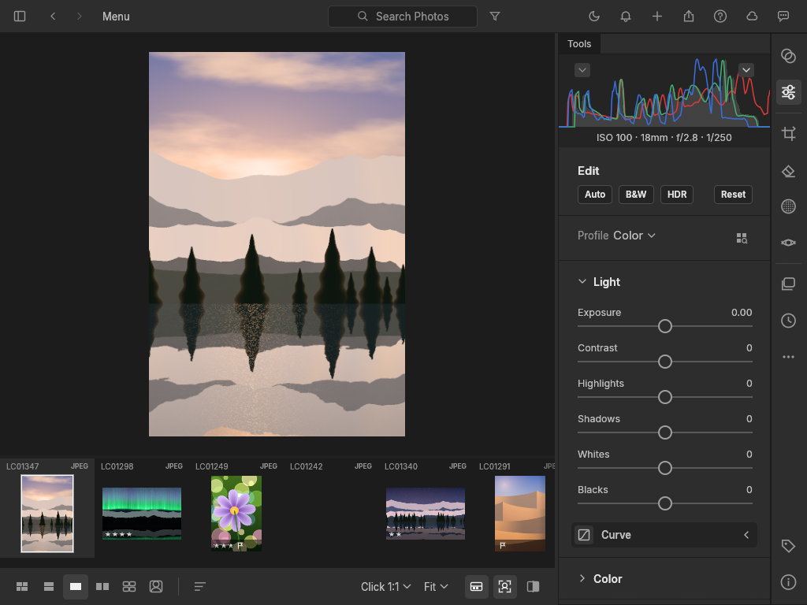
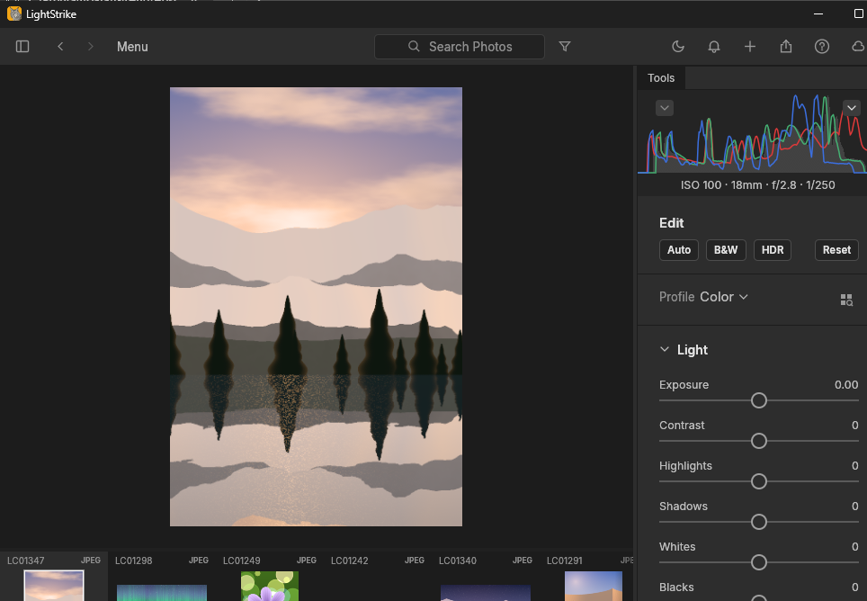
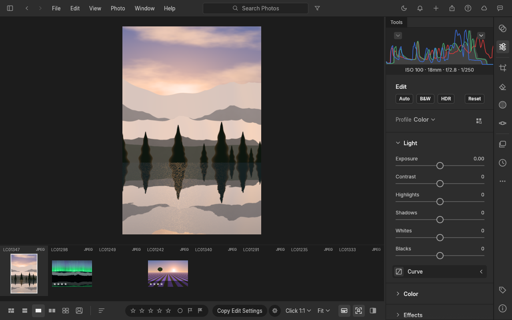

<p align="center">
  
</p>

<p align="center">
  
</p>
<p align="center"><strong>Published by PWDS</strong></p>

<h1 align="center">LightStrike</h1>

**An open-source photo library and non-destructive developer built in Rust.** Organize photographs, refine them with persistent adjustments, and export the result from a native desktop application or its CLI.

**Status:** Early alpha. Source builds only; no public installer or release yet.

## Rust direction and migration status

- **Target:** A Rust-native photo library and non-destructive developer, adapting the selected LightCraft base rather than starting a second language rewrite.
- **Current implementation:** The [Cargo workspace](Cargo.toml) and [desktop entry point](apps/lightcraft/src/main.rs) already implement the LightCraft-based editor in Rust, alongside catalog, image-processing and CLI crates.
- **Remaining migration:** Extend and validate this Rust foundation. Representative camera RAW files, colour accuracy, large libraries, broader platform behavior and installed packages still need acceptance; early-alpha source is not release completion.



*Unmodified 1024×768 native frame captured on a standard hosted Windows 2025 runner on 23 October 2026 in [successful run 40019671051](https://github.com/Gerbzz/LightStrike/actions/runs/40019671051), exact source `1715ed86637accbfda05c42d8648205d7933bf45`. The real native photo editor with a settled procedural demo landscape, histogram, develop controls, and filmstrip. [Source, hashes and limits](docs/images/lightstrike-native-editor-windows2025-20261023.provenance.json).*

Procedural demo media, not a camera photograph or colour-accuracy test. Runtime and packaged icons are unchanged.

<details>
<summary>Earlier native capture and its original provenance</summary>



*The real LightStrike editor on a standard hosted Windows 2025 runner on 2026-10-15. Its active procedural demo image had finished rendering before capture. This pixel-exact 964×668 crop contains only the app window; the [full 1040×807 runner capture](docs/images/lightstrike-native-editor-windows2025.png) is retained. [See the green run](https://github.com/Gerbzz/LightStrike/actions/runs/38744234003).*

</details>

LightStrike is an independent, early-alpha fork of the complete [LightCraft](https://github.com/storytold/lightcraft) application. Its Rust workspace contains the desktop editor, catalog and import engine, image pipeline, raw codecs, CLI, export paths and web host. The features below are present in source; the [verified workflows](#validation-status) show what this fork has exercised.

## Features

- **Browse and cull:** import files into a persistent library, inspect images in the loupe and filmstrip, and use catalog metadata.
- **Develop non-destructively:** adjustment controls, masks and presets are represented in the application. Edits remain in the library while originals stay intact.
- **Export and automate:** render developed photographs through the native UI or `lightcraft-cli`. Internal crate and binary names remain `lightcraft-*` for compatibility.



*A separate 1280×800 native Ubuntu editor capture from a 2026-10-15 [green hosted run](https://github.com/Gerbzz/LightStrike/actions/runs/38723828993). The loupe image is procedural demo media, not a licensed camera photograph; background thumbnails were still queued on the unoptimized CPU runner.*

## Build and install

Install Rust 1.95 or newer and the native graphics/windowing dependencies for your OS. The following build excludes optional default denoise dependencies, matching the hosted source checks:

```sh
git clone https://github.com/Gerbzz/LightStrike.git
cd LightStrike
cargo build --locked --no-default-features -p lightcraft -p lightcraft-cli
cargo run --locked --no-default-features -p lightcraft
cargo run --locked --no-default-features -p lightcraft-cli -- snapshot --demo -o preview.png --size 1600x1000
```

These are source commands, not installer instructions. The native library workflow and exact synthetic verification are documented in [docs/LIGHTSTRIKE_STATUS.md](docs/LIGHTSTRIKE_STATUS.md).

## Validation status

| Environment | Result |
| --- | --- |
| [Windows 2025](https://github.com/Gerbzz/LightStrike/actions/runs/38744234003) | Built the full editor and CLI; generated and imported PNG and JPEG images; saved exposure 0.75 in a library; reopened the edit in another process; exported 60×40 and 48×32 PNGs; confirmed the imported original's hash was unchanged; and captured the settled native editor above. |
| [Ubuntu 24.04](https://github.com/Gerbzz/LightStrike/actions/runs/38723828993) | Built the editor and CLI; imported, edited and exported generated images; launched the real desktop app under Xvfb/Glow and captured the native editor after its active render settled. |
| [Headless UI and export](https://github.com/Gerbzz/LightStrike/actions/runs/38721570167) | Captured the [startup](docs/images/lightstrike-startup-headless.png) and [About](docs/images/lightstrike-about-headless.png) views through the egui snapshot path, plus a [synthetic export](docs/images/lightstrike-synthetic-export.png). These are UI renders, not native-window screenshots. |

The historical 2026-10-15 images and verification in the table were produced from application code reviewed and merged in [PR #1](https://github.com/Gerbzz/LightStrike/pull/1). The new 2026-10-23 native capture above comes from [PR #5](https://github.com/Gerbzz/LightStrike/pull/5), exact source `1715ed86637accbfda05c42d8648205d7933bf45`, in [run 40019671051](https://github.com/Gerbzz/LightStrike/actions/runs/40019671051). Real camera RAW variants, colour accuracy, lens profiles, masks, high-DPI behavior, macOS, large libraries and installed packages need representative testing. This repository offers **no public installer or release** yet. See the [verification ledger](docs/LIGHTSTRIKE_STATUS.md) and [upstream roadmap](ROADMAP.md).

## Credits and licenses

The full application foundation is pinned to [LightCraft commit `0da998f24dfc03069d49867f8877af2bf7c51f94`](https://github.com/storytold/lightcraft/commit/0da998f24dfc03069d49867f8877af2bf7c51f94). The original [MIT](LICENSE-MIT) and [Apache-2.0](LICENSE-APACHE) licences, [NOTICE](NOTICE) and [asset attribution](assets/ATTRIBUTION.md) remain. The inherited openly licensed lynx app icon is temporary LightCraft artwork, not a finished LightStrike icon.

LightStrike is published by PWDS. Its existing mark has [separate brand terms](assets/branding/LICENSE-brand.txt). LightStrike is independent of and not endorsed by ArtCraft.

## Product artwork

The LightStrike product mark above has an original [SVG master](assets/branding/LightStrike-logo.svg) and matching PNG. [Asset provenance](assets/branding/LightStrike-logo.provenance.json) records how it was created and the exact file hashes. The PWDS publisher artwork and inherited software credits are unchanged. Existing screenshots retain the artwork visible in their original captured builds.

### Approved runtime branding (25 October 2026)

The exact approved [SVG master](assets/branding/LightStrike-logo.svg) is retained as vector artwork. Desktop and packaged icon references use full-page exports without cropping, recoloring, or adding padding. Existing upstream artwork and licence notices are preserved. [Export manifest](assets/branding/platform/manifest.json) and `python tools/export_approved_branding.py --check` bind the derived assets and runtime references to the approved SHA-256. Regenerate with `python tools/export_approved_branding.py` (Inkscape and Pillow). Native platform acceptance of these new exports remains **unknown**; older screenshots are historical.

The macOS DMG backdrop retains its original surrounding layout and outlined text, replacing only the embedded logo with the complete approved SVG page. Regenerate via `python tools/export_approved_dmg.py`; the existing TIFF writer preserves 1x/2x frames. Native Finder/installer acceptance remains unknown.
