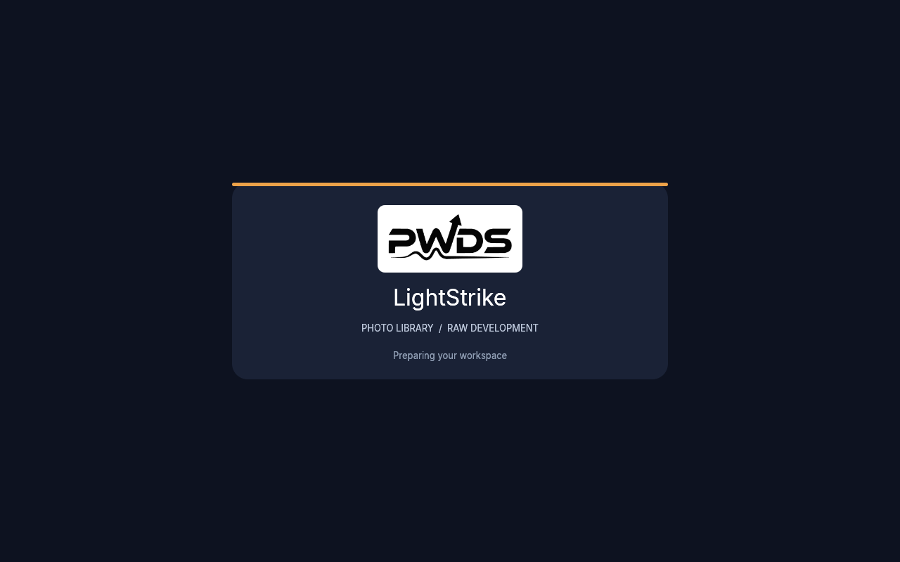
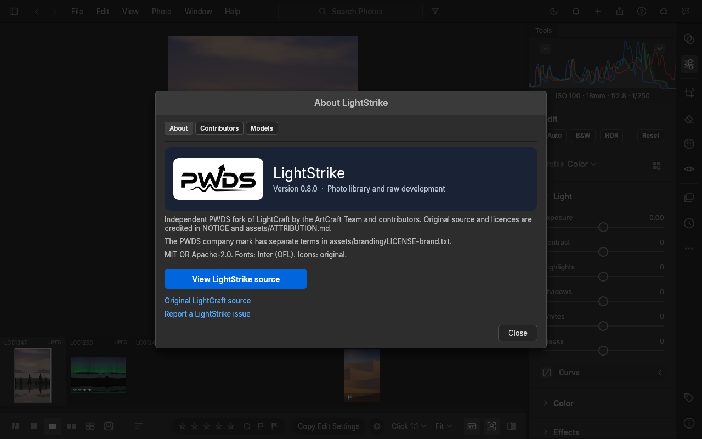

# LightStrike

LightStrike is a public, independent PWDS source fork of [LightCraft](https://github.com/storytold/lightcraft), a photo library and non-destructive raw developer written in Rust. This repository contains the complete application workspace: desktop UI, headless CLI, web host, catalog, image pipeline, raw codecs, exports, and supporting crates. It is not a mock interface or an extracted library.

The source snapshot is pinned to LightCraft commit [`0da998f24dfc03069d49867f8877af2bf7c51f94`](https://github.com/storytold/lightcraft/commit/0da998f24dfc03069d49867f8877af2bf7c51f94). Internal `lightcraft-*` crate and binary names remain for compatibility while the visible product identity is being integrated. See [integration status](docs/LIGHTSTRIKE_STATUS.md) for verified work and open gaps.

## Source and licences

The inherited software is available under MIT OR Apache-2.0; see [NOTICE](NOTICE), [MIT](LICENSE-MIT), [Apache-2.0](LICENSE-APACHE), and the [asset attribution index](assets/ATTRIBUTION.md). Upstream `docs/brand/` contains ArtCraft trademarks under separate terms and is deliberately absent from this repository's public root history. The existing PWDS mark used for LightStrike is under [its own terms](assets/branding/LICENSE-brand.txt). The inherited lynx app icon is openly licensed, but remains temporary LightCraft artwork until an approved LightStrike icon is available.

## Build and workflow

The upstream workspace requires Rust 1.95 for its UI crate. Native binaries still use upstream package names:

```sh
cargo run --release -p lightcraft
cargo run --release -p lightcraft-cli -- render input.png -o output.png --set light.exposure=0.5
cargo run --release -p lightcraft-cli -- snapshot --demo -o home.png --size 1600x1000
cargo run --release -p lightcraft-cli -- snapshot --demo --startup-brand -o startup.png --size 1280x800
```

The photo workflow is library import, culling, non-destructive development, persisted edits, reopen, and export. The synthetic import/edit/reopen/export baseline is recorded below and in the status document; it does not establish support for every raw camera, GPU, or platform.

## Captures from the verified hosted run

[Ubuntu 24.04 run 38721570167](https://github.com/Gerbzz/LightStrike/actions/runs/38721570167) built the desktop and CLI binaries at code commit `f8682b2`. These unchanged images were rendered by the real egui UI headlessly on the CPU at 1280×800, then downloaded and inspected. They do not establish native-window acceptance. The [asset index](assets/ATTRIBUTION.md) and sidecars give source and licence details.





The [synthetic edited PNG](docs/images/lightstrike-synthetic-export.png) was produced by the same run's import, edit, save, reopen, and export check.

## Current limits

LightCraft's own [roadmap](ROADMAP.md) calls the source alpha. Camera colour calibration, raw variants, lens profiles, render fidelity, AI masks, and platform validation remain substantial work. LightStrike's own release and installer readiness will be tracked in [status](docs/LIGHTSTRIKE_STATUS.md). No ArtCraft endorsement is implied.
